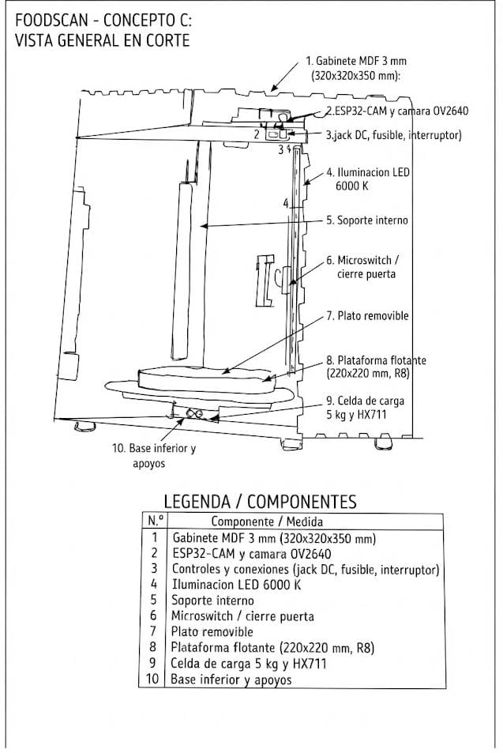
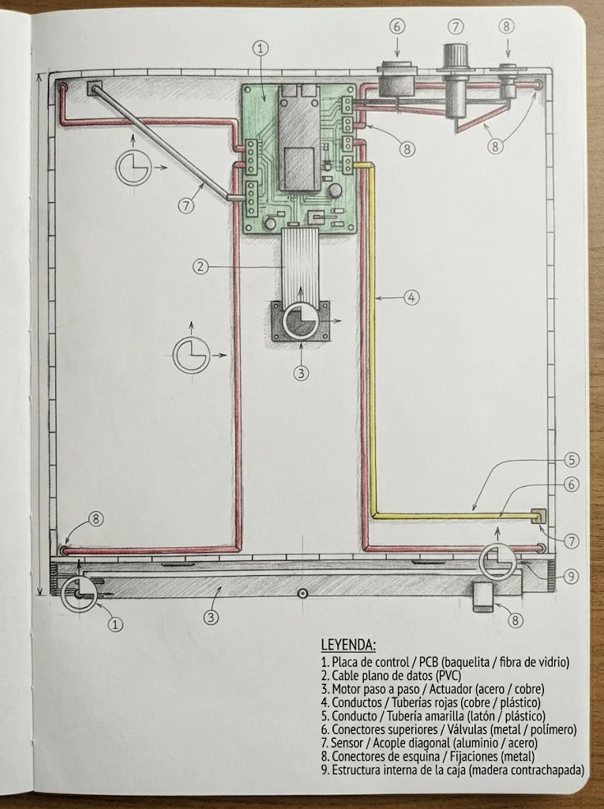
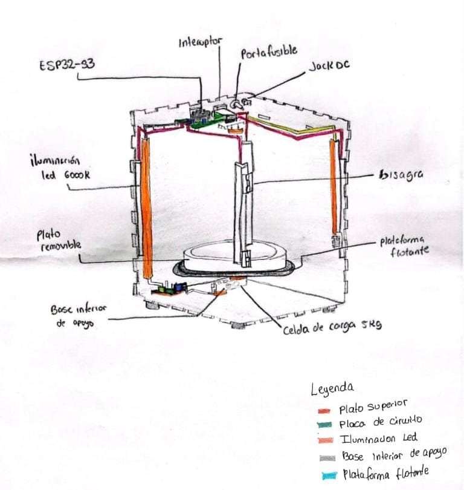

# Bocetos de FoodScan · Vistas 1 a 4

**Equipo 10 · Entregable 3 · 18 de noviembre de 2026**

Imágenes proporcionadas por el equipo, presentadas en el orden indicado. La cuarta corresponde a la vista interna a color.

## Vista 1

Vista general en corte del Concepto C, con gabinete, iluminación, plato removible, plataforma de pesaje y apoyos.

## Vista 2

Distribución de componentes y conexiones en el interior de la estructura, con elementos numerados y su leyenda.

## Vista 3

Vista frontal con puerta, bisagras, manija, mandos y apoyos inferiores.

## Vista 4 · Vista interna

Vista interna a color con la placa ESP32-S3, iluminación, plato removible, plataforma flotante, celda de carga y base de apoyo.

## Matriz morfológica

El concepto C corresponde a la caja integrada. La matriz está en las páginas 24 y 25 del [informe corregido del Entregable 2](../../../Informe_Entregable_2_Equipo10_Corregido_v2.pdf).
