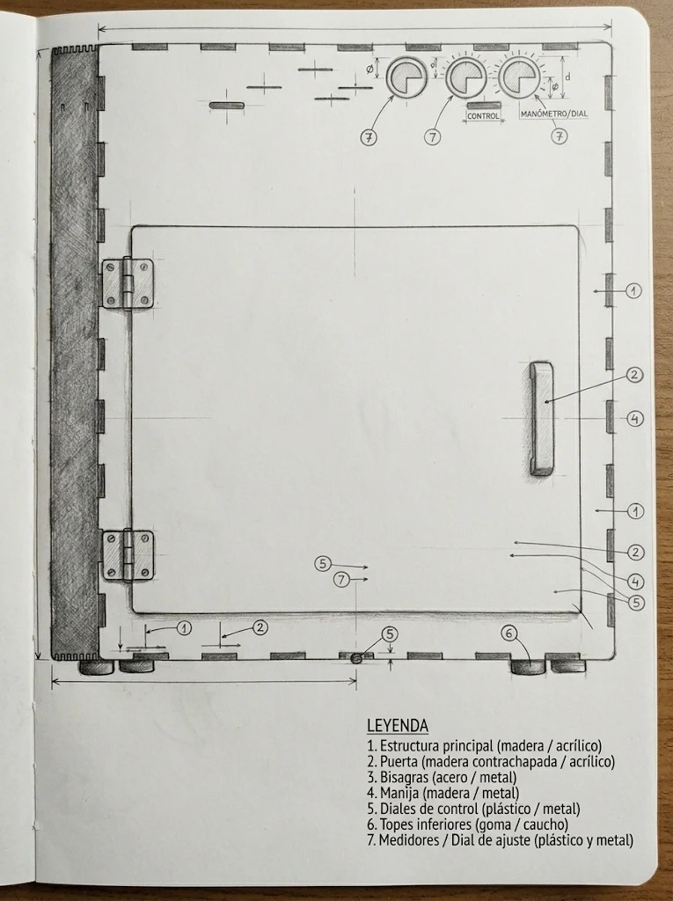

# Bocetos de FoodScan · Vistas 1 a 4

**Equipo 10 · Entregable 3 · 18 de noviembre de 2026**

Imágenes proporcionadas por el equipo, presentadas en el orden indicado. La cuarta corresponde a la vista interna a color.

## Vista 1

Vista general en corte del Concepto C, con gabinete, iluminación, plato removible, plataforma de pesaje y apoyos.

## Vista 2

Distribución de componentes y conexiones en el interior de la estructura, con elementos numerados y su leyenda.

## Vista 3

Vista frontal con puerta, bisagras, manija, mandos y apoyos inferiores.

## Vista 4 · Vista interna

Vista interna a color con la placa ESP32-S3, iluminación, plato removible, plataforma flotante, celda de carga y base de apoyo.

## Revisión para la entrega

Las cuatro imágenes se conservan tal como fueron recibidas. Revisar sus leyendas con la [lista vigente de componentes](../../../../../Proyecto/MóduloElectrónico/BOM.md) y el [esquemático v6](../../../../../Proyecto/MóduloElectrónico/EasyEDA/FoodScan_Esquematico_v6.eprj2): la vista 1 rotula ESP32-CAM/OV2640 y MDF de 3 mm; la vista 2 menciona motor, tuberías y válvulas; las vistas 1 y 4 muestran una entrada jack DC. Esas referencias requieren actualización o justificación frente al montaje vigente.

La consigna solicita **tres bocetos derivados de la matriz morfológica**, cada uno con al menos **tres vistas externas y una interior a color**. Aquí se documentan las cuatro vistas recibidas; completar la relación con la matriz y las demás propuestas en [Boceto 02](../Boceto_02/Boceto_02.md) y [Boceto 03](../Boceto_03/Boceto_03.md). Las vistas 1 y 2 muestran cortes o interiores y deben distinguirse de las vistas externas solicitadas.
