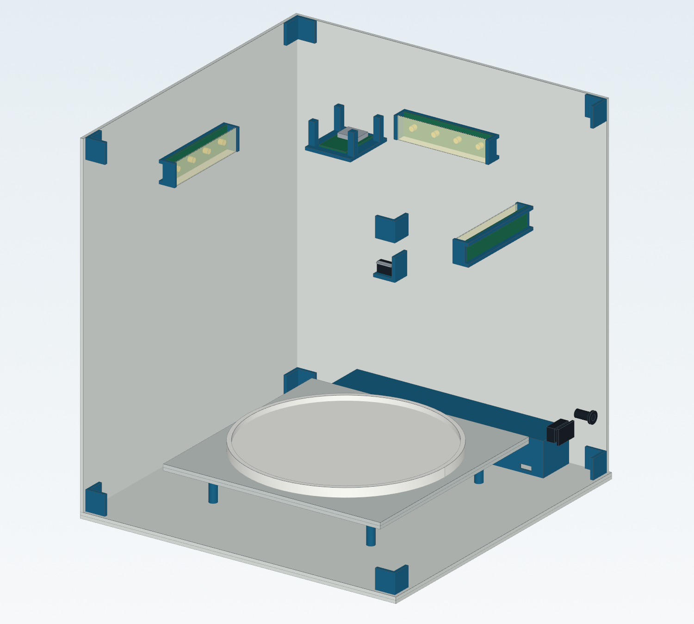

# Taller 11 - FoodScan: esquema eléctrico y modelo 3D

**Equipo 10 · Fundamentos de Diseño · 28 de octubre de 2026**

## Entregables

| Trabajo | Documento / enlace |
|---|---|
| Modelo 3D en Onshape | [Abrir FoodScan en Onshape](https://cad.onshape.com/documents/6371db0cdada012e678cb023/w/355e492b405585520bd45e0d/e/5fa7184819c33dff05c63f25?renderMode=0&uiState=6ae2cee7440795f4516e4027) |
| Esquema eléctrico en PDF | [FoodScan - esquema de interconexión](Taller_11/FoodScan_Esquematico_v1.pdf) |
| Planos acotados en PDF | [FoodScan - conjunto, paneles y detalles de montaje](Taller_11/FoodScan_Planos_acotados_v1.pdf) |
| Electrónica editable y lista de componentes | [Módulo electrónico: EasyEDA, BOM y verificación](../../Proyecto/MóduloElectrónico/README.md) |
| Modelos CAD, piezas y vistas | [Módulo mecánico: STEP, STL y documentación](../../Proyecto/MóduloMecánico/README.md) |
| Paquete descargable | [Modelo y planos del taller S11](../../output/mecanica/FoodScan_S11_Modelo_y_Planos.zip) |

## Prototipo

FoodScan es una caja de captura y pesaje con ESP32-CAM, celda de carga de 5 kg,
HX711, iluminación blanca y detector de puerta. El modelo representa la carcasa,
la puerta, la plataforma y la ubicación de los módulos electrónicos.

El cuerpo propuesto mide **320 × 320 × 350 mm**, con plataforma de
**220 × 220 mm** y cámara superior orientada al plato. Los planos incluyen
las dimensiones del conjunto, el despiece de paneles y los detalles de pesaje.

## Alcance y comprobaciones

- Esquema de interconexión de 34 componentes y 25 redes, con verificación local.
- Modelo CAD de 79 sólidos válidos, sin solapes volumétricos en la posición cerrada;
  los archivos STEP se volvieron a leer después de exportarlos.
- Planos vectoriales de tres hojas A3, revisados visualmente.
- Componentes comerciales y soportes de referencia: medidas y taladros pendientes
  de ajuste con las piezas reales. La maqueta no demuestra desempeño físico.
- La copia nativa de EasyEDA Pro conserva referencias provisionales; su estado se
  explica en las [notas de importación a Pro](../../Proyecto/MóduloElectrónico/EasyEDA/LEEME_Pro.md).

[Especificación técnica y conexiones](../../Proyecto/Especificacion_S11.md).
