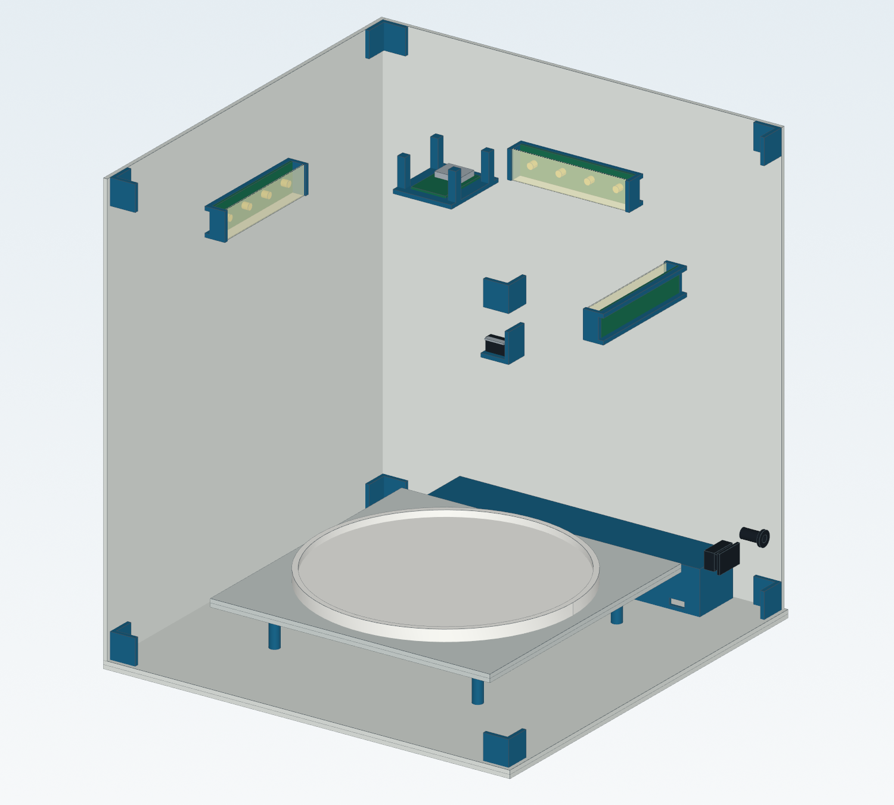

# Taller 11 - FoodScan: esquema eléctrico y modelo 3D

**Equipo 10 · Fundamentos de Diseño · Actualizado el 5 de noviembre de 2026**

## Entregables

| Trabajo | Documento / enlace |
|---|---|
| Modelo 3D vigente | [FoodScan_Onshape_v2.fs](../../Proyecto/MóduloMecánico/CAD/FoodScan_Onshape_v2.fs): FeatureScript recibido del equipo el 05/11/2026. |
| Cómo abrir el modelo | [Onshape, parámetros y alcance de v2](../../Proyecto/MóduloMecánico/README_v2.md) |
| Esquema eléctrico en PDF | [FoodScan - esquema de interconexión v2](../../Proyecto/MóduloElectrónico/EasyEDA/FoodScan_Esquematico_v2.pdf) |
| Electrónica editable y componentes | [Corrección electrónica v2: EasyEDA, BOM y verificación](Taller_11_Correccion_Electronica.md) |
| Informe técnico corregido | [Entregable 2: corrección electrónica del 04/11/2026](../Entregables/Informe_Entregable_2_Equipo10_Corregido_v2.pdf) |

## Prototipo

FoodScan integra una ESP32-S3 N16R8, cámara OV5640 (C) independiente, celda de
carga de 5 kg, HX711, iluminación blanca con control MOSFET y detector de puerta.
El modelo vigente define carcasa, puerta, bandeja y ubicación de los módulos.
Sus valores predeterminados son **310 × 300 × 415 mm** (ancho, fondo sin puerta
y alto sin patas), MDF de **3,5 mm** y plato de referencia de **Ø220 mm**.

El archivo nuevo reemplaza al conjunto v1 como fuente principal. La revisión
comprueba el archivo recibido, no su compilación o el ensamble dentro de una
cuenta de Onshape. Los planos y las figuras del informe del 04/11 siguen siendo
los bocetos anteriores, identificados como tales.

## Archivo histórico: entrega v1 del 28 de octubre de 2026

Los siguientes archivos, imágenes, cotas y comprobaciones corresponden
exclusivamente al modelo anterior.

| Archivo anterior | Enlace |
|---|---|
| Planos acotados v1 | [Conjunto, paneles y detalles de montaje](Taller_11/FoodScan_Planos_acotados_v1.pdf) |
| STEP, STL y vistas v1 | [Documentación mecánica anterior](../../Proyecto/MóduloMecánico/README.md) |
| Paquete descargable v1 | [Modelo y planos S11 anteriores](../../output/mecanica/FoodScan_S11_Modelo_y_Planos.zip) |

El cuerpo propuesto mide **320 × 320 × 350 mm**, con plataforma de
**220 × 220 mm** y cámara superior orientada al plato. Los planos incluyen
las dimensiones del conjunto, el despiece de paneles y los detalles de pesaje.

### Alcance y comprobaciones de v1

- Esquema de interconexión de 34 componentes y 25 redes, con verificación local.
- Modelo CAD de 79 sólidos válidos, sin solapes volumétricos en la posición cerrada;
  los archivos STEP se volvieron a leer después de exportarlos.
- Planos vectoriales de tres hojas A3, revisados visualmente.
- Componentes comerciales y soportes de referencia: medidas y taladros pendientes
  de ajuste con las piezas reales. La maqueta no demuestra desempeño físico.
- La copia nativa de EasyEDA Pro conserva referencias provisionales; su estado se
  explica en las [notas de importación a Pro](../../Proyecto/MóduloElectrónico/EasyEDA/LEEME_Pro.md).

[Especificación técnica y conexiones](../../Proyecto/Especificacion_S11.md).
