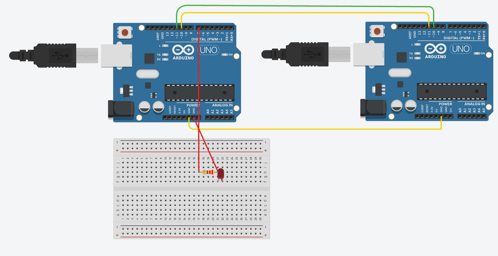

# Tarea — Reto 4: propuesta libre

## Enunciado

**Reto N.° 4. Propuesta libre (3 puntos)**

Proponga e implemente un escenario de comunicación bajo cualquiera de los siguientes esquemas:

- Microcontrolador y microcontrolador.
- Microcontrolador y sensor.

Que permita observar un intercambio de datos o mensajes.

Utilice los kits disponibles del laboratorio.

## Circuito en Tinkercad



[Abrir proyecto en Tinkercad](https://www.tinkercad.com/things/iTQ5tdo63qM-exquisite-amur-jofo/editel?returnTo=https://www.tinkercad.com/dashboard&sharecode=j5uvqdkyx_MuO2OfW03efWzq-4KArazZlnB_UeRoExk)

## Código

### Arduino_uno_Emisor

```cpp
#include <SoftwareSerial.h>

// RX = 10, TX = 11
SoftwareSerial comunicacion(10, 11);

const int led = 7;
unsigned long tiempoAnterior = 0;

void setup() {
  pinMode(led, OUTPUT);

  comunicacion.begin(9600);
  Serial.begin(9600);

  Serial.println("Arduino emisor iniciado");
}

void loop() {
  // Enviar un mensaje cada 2 segundos
  if (millis() - tiempoAnterior >= 2000) {
    tiempoAnterior = millis();

    comunicacion.println("HOLA");
    Serial.println("Enviado: HOLA");
  }

  // Esperar la respuesta del receptor
  if (comunicacion.available()) {
    String respuesta =
      comunicacion.readStringUntil('\n');

    respuesta.trim();

    Serial.print("Respuesta recibida: ");
    Serial.println(respuesta);

    if (respuesta == "RECIBIDO") {
      digitalWrite(led, HIGH);
      delay(300);
      digitalWrite(led, LOW);
    }
  }
}
```

### Arduino_uno_Receptor

```cpp
#include <SoftwareSerial.h>

// RX = 10, TX = 11
SoftwareSerial comunicacion(10, 11);

void setup() {
  comunicacion.begin(9600);
  Serial.begin(9600);

  Serial.println("Arduino receptor iniciado");
}

void loop() {
  // Comprobar si llego un mensaje
  if (comunicacion.available()) {
    String mensaje =
      comunicacion.readStringUntil('\n');

    mensaje.trim();

    Serial.print("Mensaje recibido: ");
    Serial.println(mensaje);

    // Responder si el mensaje es correcto
    if (mensaje == "HOLA") {
      comunicacion.println("RECIBIDO");
      Serial.println("Respuesta enviada: RECIBIDO");
    }
  }
}
```
